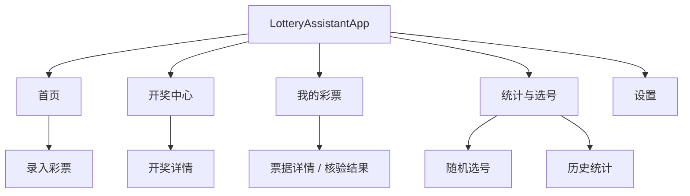
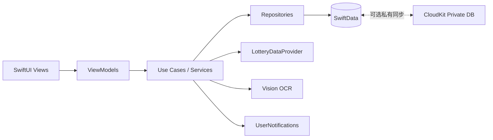
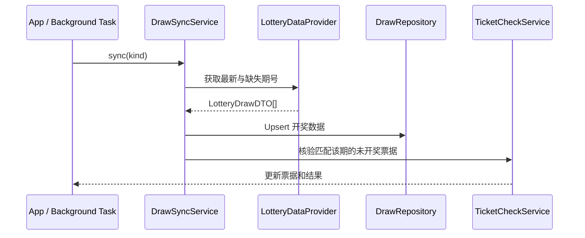
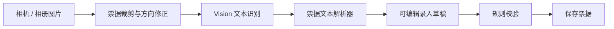
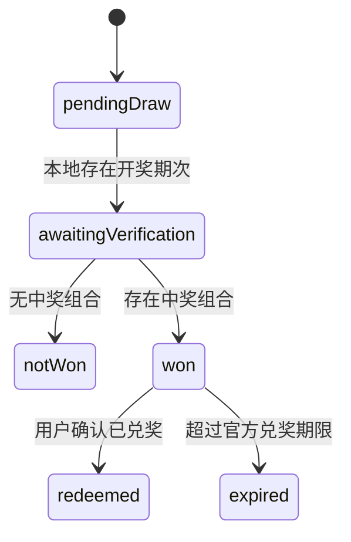

# 彩票助手 iOS App 技术设计文档

**版本：** 0.1（方案评审稿）  
**平台：** iOS 17+  
**技术栈：** Swift 5.9+、SwiftUI、SwiftData、CloudKit、Vision、UserNotifications  
**产品定位：** 本地彩票记录、开奖查询与中奖核验工具；不提供购彩、支付或任何“保证中奖”的预测服务。

---

## 1. 目标与边界

### 1.1 核心目标

1. 查询双色球、超级大乐透的历史开奖数据。
2. 通过 OCR 扫描或手工录入保存用户的彩票。
3. 在开奖后自动核验已保存的彩票，并展示命中号码和中奖等级。
4. 使用 SwiftData 保存票据、开奖数据、模板及统计所需的本地数据，并可选同步到用户私有 iCloud。
5. 基于历史数据提供可视化统计和随机选号；统计结果仅供娱乐。

### 1.2 非目标

- 不接入线上购彩、代购、支付、账户余额或兑奖服务。
- 不宣称、暗示或实现能够预测下期中奖号码的算法。
- 不以未授权方式抓取、再分发官方或第三方数据。
- 首期不覆盖全部彩票品种；只支持双色球与超级大乐透。

### 1.3 合规与风险原则

- 开奖号码和奖金信息应来自经确认可使用的官方公开渠道或已签约数据供应商。
- 所有奖金结果显示为“预计结果，以官方兑奖为准”；玩法、奖级、税费和兑奖期限以当期官方规则为准。
- “趋势”“冷热号”“遗漏”等功能必须在首次展示和设置页明确标记“仅供娱乐，历史数据不具备预测能力”。
- 票据照片、购买记录默认只存储在设备和用户私有 iCloud，不上传至应用自有服务器。

---

## 2. 用户场景与功能范围

| 场景 | 用户目标 | 首期支持 |
| --- | --- | --- |
| 查看开奖 | 查询某一期或历史期的开奖号码、开奖日期、奖池 | 是 |
| 保存彩票 | 扫描纸质票据或手工选择号码、玩法、倍数和期号 | 是 |
| 自动核验 | 开奖数据更新后，核验未开奖票据 | 是 |
| 中奖管理 | 查看命中情况、预计奖金、标记已兑奖 | 是 |
| 管理账本 | 统计购买金额、中奖金额、净收益 | 是 |
| 随机选号 | 生成双色球或大乐透的单注号码并保存 | 是 |
| 娱乐统计 | 展示频率、遗漏、奇偶比、区间分布 | 是 |
| 预测推荐 | 声称提高中奖率或给出“必中”号码 | 否 |

### 2.1 MVP 功能清单

1. 首页：最近开奖、待开奖彩票、待核验彩票、快捷录入。
2. 开奖中心：按彩种浏览历史期号，按期号检索，查看开奖详情。
3. 彩票录入：手工录入和 OCR 草稿识别；支持单式、复式、胆拖（第二阶段）、倍投，以及大乐透追加。
4. 票据库：按彩种、开奖状态、购买日期和兑奖状态筛选。
5. 核验结果：命中号高亮、奖级、预计奖金、规则版本与核验时间。
6. 数据看板：投入、中奖、净收益、月度趋势。
7. 号码工具：随机选号和常用号码模板。
8. 设置：数据来源、同步状态、通知、隐私与免责声明。

---

## 3. 信息架构



### 3.1 SwiftUI 页面职责

| 页面 | 职责 | 关键状态 |
| --- | --- | --- |
| `HomeView` | 汇总展示与导航 | 最近开奖、待核验数、快捷入口 |
| `DrawListView` | 历史开奖列表 | 彩种、期号搜索、分页/按需加载 |
| `DrawDetailView` | 展示单期开奖详情 | 开奖号码、奖级、奖池、数据来源 |
| `TicketEntryView` | 新建或编辑彩票 | 玩法、号码、倍数、期号、购买信息 |
| `TicketScannerView` | 票据图像采集与 OCR 校对 | 照片、识别草稿、识别置信度 |
| `TicketListView` | 管理所有票据 | 筛选、排序、批量操作 |
| `TicketDetailView` | 核验票据与兑奖管理 | 核验结果、兑奖状态、票据照片 |
| `StatisticsView` | 展示历史统计 | 彩种、统计周期、免责声明 |
| `RandomPickerView` | 随机生成号码 | 彩种、注数、保留/排除号码 |
| `SettingsView` | 配置同步、通知与隐私 | 数据源状态、iCloud、通知权限 |

---

## 4. 总体架构

采用 **MVVM + Service + Repository** 分层，View 只负责渲染和交互绑定；规则计算、OCR、数据同步和持久化不放入 SwiftUI View。



### 4.1 模块划分

| 模块 | 职责 |
| --- | --- |
| `App` | 应用入口、依赖装配、SwiftData `ModelContainer`、根导航 |
| `Features/Draws` | 开奖列表、详情、数据同步状态 |
| `Features/Tickets` | 票据录入、扫描、列表、详情、兑奖状态 |
| `Features/Insights` | 统计、随机选号、常用号码模板 |
| `Domain` | 彩种、玩法、规则、中奖核验、值对象与错误定义 |
| `Data` | SwiftData Repository、DTO 映射、远程数据 Provider |
| `Services` | OCR、通知、同步编排、图片文件管理 |
| `DesignSystem` | 色彩、间距、号码球、状态标签、无障碍样式 |

### 4.2 依赖注入

应用启动时在 `AppDependencies` 组装协议实现，再由环境注入 ViewModel 工厂。业务代码仅依赖协议，单元测试可注入内存仓储和固定开奖数据。

```swift
protocol LotteryDataProviding: Sendable {
    func latestDraw(for lottery: LotteryKind) async throws -> LotteryDrawDTO?
    func draws(for lottery: LotteryKind, before issue: String?) async throws -> [LotteryDrawDTO]
}

protocol TicketRepository: Sendable {
    func save(_ ticket: LotteryTicket) throws
    func tickets(requiringCheckFor draw: LotteryDraw) throws -> [LotteryTicket]
}

protocol PrizeChecking: Sendable {
    func check(ticket: LotteryTicket, against draw: LotteryDraw) throws -> PrizeResult
}
```

---

## 5. 领域模型与 SwiftData 设计

### 5.1 核心枚举

```swift
enum LotteryKind: String, Codable, CaseIterable {
    case doubleColorBall
    case superLotto
}

enum TicketStatus: String, Codable {
    case pendingDraw
    case awaitingVerification
    case notWon
    case won
    case redeemed
    case expired
}

enum TicketPlayType: String, Codable {
    case single
    case multiple
    case dantuo
}
```

### 5.2 持久化实体

| 实体 | 主要字段 | 关系/索引 |
| --- | --- | --- |
| `LotteryDraw` | `lotteryRawValue`、`issueNumber`、`drawDate`、`frontNumbers`、`backNumbers`、`poolAmount`、`sourceURL`、`rulesVersion` | `(lotteryRawValue, issueNumber)` 唯一 |
| `LotteryTicket` | `id`、`lotteryRawValue`、`issueNumber`、`purchaseDate`、`multiplier`、`isAdditional`、`statusRawValue`、`imageFileName` | 与 `TicketEntry` 一对多；与 `PrizeResult` 一对一 |
| `TicketEntry` | `playTypeRawValue`、`frontNumbers`、`backNumbers`、`frontDanNumbers`、`backDanNumbers` | 归属一张 `LotteryTicket` |
| `PrizeResult` | `checkedAt`、`matchedFrontCount`、`matchedBackCount`、`prizeLevel`、`estimatedAmount`、`rulesVersion` | 归属 `LotteryTicket`，保留核验快照 |
| `NumberTemplate` | `name`、`lotteryRawValue`、`frontNumbers`、`backNumbers` | 用户常用号码 |
| `SyncMetadata` | `lotteryRawValue`、`lastSyncedIssue`、`lastSyncedAt`、`lastError` | 每个彩种一条 |

> 号码数组建议以规范化字符串持久化，例如 `"01,07,13,22,31,33"`。在领域层转换为 `[Int]`，并对范围、数量、重复值及排序做严格校验。

### 5.3 SwiftData 关系示例

```swift
@Model
final class LotteryTicket {
    @Attribute(.unique) var id: UUID
    var lotteryRawValue: String
    var issueNumber: String
    var purchaseDate: Date
    var multiplier: Int
    var isAdditional: Bool
    var statusRawValue: String
    var imageFileName: String?

    @Relationship(deleteRule: .cascade, inverse: \TicketEntry.ticket)
    var entries: [TicketEntry]

    @Relationship(deleteRule: .cascade)
    var prizeResult: PrizeResult?

    init(
        lotteryRawValue: String,
        issueNumber: String,
        purchaseDate: Date = .now,
        multiplier: Int = 1,
        isAdditional: Bool = false,
        statusRawValue: String = TicketStatus.pendingDraw.rawValue
    ) {
        self.id = UUID()
        self.lotteryRawValue = lotteryRawValue
        self.issueNumber = issueNumber
        self.purchaseDate = purchaseDate
        self.multiplier = multiplier
        self.isAdditional = isAdditional
        self.statusRawValue = statusRawValue
        self.entries = []
    }
}
```

票据图片不保存为 SwiftData `Data`：图片经压缩后存入 Application Support，SwiftData 仅保存文件名。删除票据时由 `TicketImageStore` 删除对应文件；iCloud 同步开启时另行评估用户私有资产同步策略。

---

## 6. 开奖数据同步

### 6.1 Provider 抽象

首期不绑定特定网站的 HTML 结构。通过 `LotteryDataProviding` 隔离数据来源；接口实现可以是官方许可 API、合作数据服务，或导入的受信任数据文件。



### 6.2 同步策略

1. App 冷启动、进入前台及用户下拉刷新时同步最近数据。
2. 使用 `BGAppRefreshTask` 注册低频后台刷新；系统不保证精确的开奖后执行时间。
3. 每次仅请求本地最后一期之后的缺失期号，使用幂等 upsert 防止重复。
4. 网络、解析、数据校验失败时保留既有数据并显示可重试状态；不得以空结果覆盖有效历史记录。
5. 保存 `sourceURL`、抓取时间和规则版本，用于结果追溯。

### 6.3 数据验证

- 双色球：红球 6 个，范围 1...33；蓝球 1 个，范围 1...16。
- 大乐透：前区 5 个，范围 1...35；后区 2 个，范围 1...12。
- 数量不足、重复、越界、期号或日期无法解析时，整个期次拒绝入库并记录显式同步错误。

---

## 7. 票据录入与 OCR

### 7.1 手工录入

号码选择器使用网格号码球，选择状态、可选数量和玩法约束由 `TicketEntryViewModel` 管理。提交前由领域校验器验证：

- 期号不能为空且符合当前彩种期号格式。
- 单式、复式、胆拖的号码数量符合对应规则。
- 倍数必须为正整数且在业务规则允许范围内。
- “追加”只可用于大乐透。

### 7.2 OCR 扫描流程



1. 使用 `VNRecognizeTextRequest` 获取文本块与置信度。
2. `TicketOCRParser` 仅尝试提取可能的期号、号码、倍数和追加标记，不直接保存正式票据。
3. 当号码、期号或玩法存在歧义，必须进入人工确认页面；低置信度字段用明显样式提示。
4. 用户确认后才生成 `LotteryTicket`。OCR 失败必须显示明确错误和手动录入入口，不能创建空票据。

### 7.3 票据图片权限与隐私

- 优先使用 `PhotosPicker`；拍照时按需申请相机权限。
- 不请求全量相册访问权限。
- 提供“保存原始票据照片”开关；关闭时只保存录入号码，不保留图片。

---

## 8. 中奖核验与奖金计算

### 8.1 规则引擎

`PrizeCheckingService` 根据彩种、玩法、规则版本和开奖期次计算结果。每个彩种实现独立策略，禁止在 ViewModel 中以条件分支直接计算奖级。

```swift
protocol LotteryRule: Sendable {
    var kind: LotteryKind { get }

    func validate(entry: TicketEntryInput) throws
    func evaluate(
        entry: TicketEntryInput,
        draw: LotteryDraw,
        multiplier: Int,
        isAdditional: Bool
    ) throws -> PrizeEvaluation
}
```

### 8.2 核验规则

1. 只比较相同彩种和相同期号的票据与开奖数据。
2. 对一张包含多注的票据逐注计算命中数和奖级，再合并为一份 `PrizeResult`。
3. 多倍按规则放大奖金；大乐透追加仅在规则允许的奖级生效。
4. 复式、胆拖以拆分组合或组合计数方式计算，避免遗漏任一注。
5. 奖金计算必须带 `rulesVersion`；规则或浮动奖金额度不可确认时，将结果标为“待官方确认”，而非伪造精确金额。

### 8.3 状态迁移



---

## 9. 统计与随机选号

### 9.1 可展示的历史统计

- 单个号码的出现次数与最近出现期数。
- 号码区间分布、奇偶比、大小比、连号次数。
- 前后区组合分布及时间范围筛选。
- 用户个人的购买金额、中奖金额、净收益和按月趋势。

所有统计都应显示样本范围、最后更新时间和以下固定提示：

> 彩票开奖结果为随机事件。历史统计仅用于数据浏览和娱乐，不会提高任何号码组合的中奖概率。

### 9.2 随机选号

使用 `SystemRandomNumberGenerator` / `Int.random(in:using:)` 进行无重复抽样，按升序展示结果。支持：

- 一次生成 1 至 N 注。
- 锁定用户指定号码后补足剩余号码。
- 排除用户不希望出现的号码。
- 保存为模板或直接创建未购买的“选号草稿”。

不得使用“AI 预测”“高概率”“推荐指数”等误导性排序。

---

## 10. 通知、同步与离线体验

### 10.1 本地通知

| 触发条件 | 通知内容 |
| --- | --- |
| 已保存票据临近开奖 | “您有 N 张彩票即将开奖” |
| 同步到对应期开奖数据 | “您的第 X 期彩票可以核验了” |
| 检测到中奖 | “检测到中奖结果，请在兑奖期限内核对官方信息” |
| 临近兑奖截止 | “您有彩票即将超过兑奖期限” |

通知须在用户授权后启用，可在设置中分别关闭。不得在通知正文中泄露完整号码或票据图片信息。

### 10.2 CloudKit

- 默认本地 SwiftData；用户在设置中主动开启 iCloud 同步。
- 仅使用用户私有数据库，不建立公共用户社交、排行榜或票据共享功能。
- 发生同步冲突时，以 `modifiedAt` 最新版本为准；兑奖状态采用更保守状态，避免自动将“已兑奖”回退。
- 必须提供“同步中 / 已同步 / 失败可重试”的可见状态。

---

## 11. 错误处理与可访问性

### 11.1 错误分类

| 错误 | 用户反馈 | 可恢复方式 |
| --- | --- | --- |
| 网络不可用 | “无法更新开奖数据，正在显示本地记录” | 重试 |
| 数据源异常 | “数据格式异常，本次未更新” | 重试 / 查看来源 |
| OCR 无法识别 | “未能确认票据号码” | 重新扫描 / 手工输入 |
| 号码校验失败 | 指出具体号码、数量或玩法错误 | 修改后保存 |
| 规则版本缺失 | “该期奖金规则待确认” | 保留待核验状态 |
| iCloud 同步失败 | “未能同步到 iCloud，本地数据未丢失” | 重试 / 关闭同步 |

### 11.2 可访问性与适配

- 号码球提供完整的 VoiceOver 标签，例如“红球 07，已选择”。
- 支持动态字体；号码网格随字体大小重排而非裁切。
- 不仅用颜色表达中奖、错误或选中状态，同时使用图标和文字。
- 适配深色模式；所有颜色、间距、圆角来自 Design System Token。

---

## 12. 测试策略

| 层级 | 内容 | 工具 |
| --- | --- | --- |
| 单元测试 | 两种彩票规则、中奖等级、追加/倍数、复式/胆拖组合、号码校验 | XCTest |
| 单元测试 | OCR 文本解析、错误数据拒绝、随机选号无重复且范围正确 | XCTest |
| 数据层测试 | upsert 幂等性、SwiftData 关系级联、筛选查询 | XCTest + 临时 `ModelContainer` |
| UI 测试 | 手工录入、核验结果、筛选、动态字体关键路径 | XCUITest |
| 集成测试 | 固定 Provider Fixture 下的同步→保存→核验流程 | XCTest |

最优先覆盖的失败路径：

1. 开奖号码越界或重复时不能写入本地。
2. 票据期号与开奖期号不一致时不能计算中奖。
3. OCR 解析不完整时不能直接创建票据。
4. 大乐透追加不能应用于不符合规则的奖级。
5. 多次同步同一期开奖数据后不产生重复记录或重复通知。

---

## 13. 目录建议

```text
LotteryAssistant/
├── App/
│   ├── LotteryAssistantApp.swift
│   └── AppDependencies.swift
├── DesignSystem/
├── Domain/
│   ├── Models/
│   ├── Rules/
│   └── UseCases/
├── Data/
│   ├── Persistence/
│   ├── Remote/
│   └── Repositories/
├── Services/
│   ├── DrawSyncService.swift
│   ├── TicketOCRService.swift
│   ├── TicketImageStore.swift
│   └── NotificationService.swift
├── Features/
│   ├── Home/
│   ├── Draws/
│   ├── Tickets/
│   ├── Insights/
│   └── Settings/
└── Tests/
```

---

## 14. 迭代计划

### Phase 1：可用 MVP

- SwiftUI 应用骨架与 Design System。
- 双色球/大乐透开奖数据模型、Provider 抽象和本地历史展示。
- 手工录入单式号码、SwiftData 票据库、单式中奖核验。
- 随机选号、基础投入与中奖统计。

### Phase 2：自动化与完整玩法

- Vision OCR 扫描并进入人工确认。
- 后台同步、本地开奖和兑奖截止通知。
- 大乐透追加、复式与胆拖的录入和规则引擎。
- iCloud 私有同步、图片管理与导出。

### Phase 3：体验完善

- 更丰富的历史统计、号码模板和筛选。
- 边界规则与奖金规则版本管理。
- 无障碍审计、性能优化、崩溃与同步错误观测。

---

## 15. 待确认事项

1. **数据授权与来源：** 使用哪一个经过授权、稳定且允许客户端使用的开奖数据源？
2. **规则范围：** MVP 是否只做单式，还是首期必须支持复式、胆拖与大乐透追加？
3. **iCloud：** 是否要求多设备同步票据和票据图片？
4. **最低系统版本：** 本方案按 iOS 17+（SwiftData）设计；若需 iOS 16，持久层应改为 Core Data 或引入兼容层。
5. **兑奖规则：** 需要确认目标地区和官方规则版本，以便实现准确的奖金、税费和兑奖期限逻辑。
